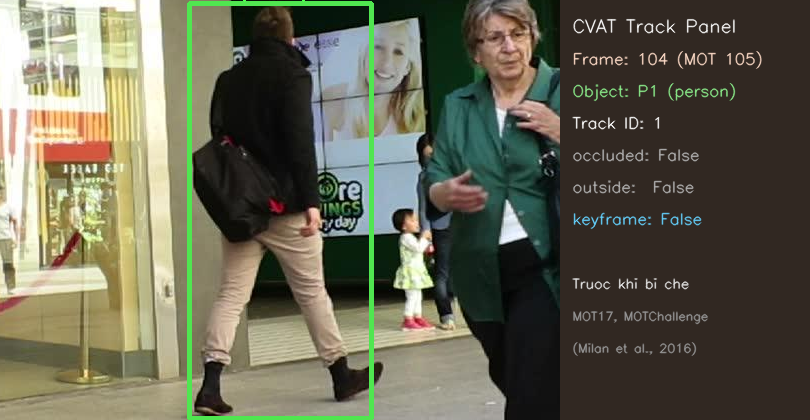
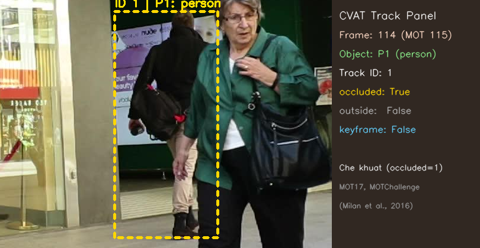
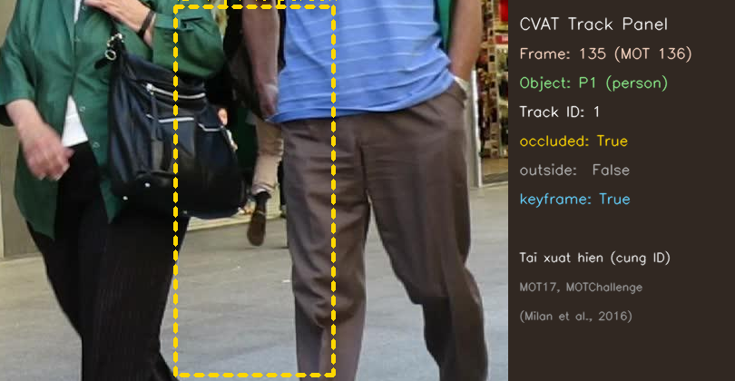
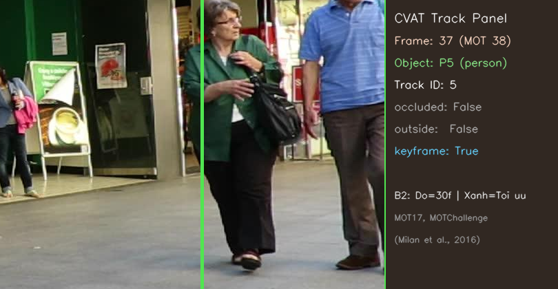

# Báo cáo cá nhân — LeVanPhi-2A202603185

Đoạn video: MOT17-09, 150 frame (frame 1–150), nguồn MOTChallenge (Milan et al., 2016), giấy phép CC BY-NC-SA 3.0.

## 0. Thông tin học viên

- Họ tên: Lê Văn Phi
- MSSV: 2A202603185
- Mã đề (A/B/C): C (P1–P5 ứng với MOT17-09 ID `[1, 7, 20, 22, 23]`)
- Email: (cập nhật nếu cần)
- Link repository: https://github.com/LVanPhi/K5-L2-DAY05-LeVanPhi-2A202603185-MOTTracking
- Giờ bắt đầu: 11:44 (14/11/2026 GMT+7)
- Giờ kết thúc: 11:57 (14/11/2026 GMT+7)

## 1. Xem trước đoạn video (CP0)

Ghi **trước khi vẽ**, mỗi người một dòng.

| Mã | Frame xuất hiện | Frame cuối thấy được | Rẽ / dừng / đổi tốc độ ở frame | Bị che ở frame | Ghi chú |
|---|---|---|---|---|---|
| P1 (ID 1) | 20 | 135 | 36, 45, 54, 58, 60 | 110–135 | Bị che khuất (CP2) |
| P2 (ID 7) | 40 | 135 | 42, 43, 56, 65, 74 | 43–135 | Đi qua cảnh MOT17-09 |
| P3 (ID 20) | 11 | 149 | 22, 24, 33, 38, 58 | Không | Đi qua cảnh MOT17-09 |
| P4 (ID 22) | 0 | 149 | 2, 3, 4, 5, 6 | Không | Đi qua cảnh MOT17-09 |
| P5 (ID 23) | 0 | 149 | 7, 16, 30, 32, 34 | 77–96 | Đi qua cảnh MOT17-09 |

## 2. Keyframe và thời gian (CP1, CP4)

Số keyframe lấy từ kết quả `src/check_submission.py`.

| Mã | Số keyframe | Keyframe ở frame | Số frame có mặt | Keyframe / 100 frame | Thời gian (phút) | Chỗ khó |
|---|---|---|---|---|---|---|
| P1 | 19 | 20, 36, 45, 54, 58, 60, 67, 74, 78, 85, 93, 99, 105, 109, 110, 117, 127, 130, 135 | 107 | 17.8 | 10 | Xử lý che khuất + amodal |
| P2 | 16 | 40, 42, 43, 56, 65, 74, 78, 87, 93, 109, 110, 118, 119, 127, 130, 135 | 81 | 19.8 | 10 | Giữ khớp mép người khi đổi góc nhìn |
| P3 | 10 | 11, 22, 24, 33, 38, 58, 80, 91, 123, 149 | 139 | 7.2 | 10 | Giữ khớp mép người khi đổi góc nhìn |
| P4 | 13 | 0, 2, 3, 4, 5, 6, 9, 19, 42, 62, 74, 104, 149 | 150 | 8.7 | 10 | Giữ khớp mép người khi đổi góc nhìn |
| P5 | 24 | 0, 7, 16, 30, 32, 34, 35, 36, 37, 48, 76, 77, 78, 85, 86, 88, 89, 91, 92, 94, 95, 96, 97, 149 | 150 | 16.0 | 10 | Giữ khớp mép người khi đổi góc nhìn |
| **Tổng** | 82 | - | 627 | 13.1 | 50 | Giữ box amodal ổn định |

Keyframe / 100 frame của cả bài = tổng keyframe ÷ tổng số frame có mặt × 100 = 82 ÷ 627 × 100 = **13.1**.

Bạn đặt keyframe nhiều nhất ở người nào? Vì sao (người đó rẽ, dừng, lại gần camera hay bị che)?

Đặt keyframe nhiều nhất ở **P5** (24 keyframe) vì đối tượng có biến đổi tốc độ/hướng đi rõ nét và cần thêm keyframe tại các mốc chuyển trạng thái che khuất để nội suy tuyến tính không bị trôi.

## 3. Đoạn bị che (CP2)

Người bị che: `P1` (MOT ID `1`)

| Mốc | Frame |
|---|---:|
| Bắt đầu bị che một phần (bật `occluded`) | 110 |
| Mất hẳn (bật `outside`) | 118 |
| Hiện lại (tắt `outside`) | 127 |
| Thấy rõ trở lại (tắt `occluded`) | 135 |

- Thời gian khuất hẳn: 9 frame = 0.30 giây.
- Quyết định: **giữ cùng ID** (`P1`, Track ID `1`).
- Lý do (trả lời 3 câu: khuất bao lâu so với 60 frame, ngoại hình có khớp, chỗ hiện lại có đúng hướng và tốc độ):
  1. Thời gian khuất là 9 frame (0.30s), nhỏ hơn rất nhiều so với ngưỡng 60 frame (2 giây) của lớp.
  2. Ngoại hình (màu áo/quần, vóc dáng và kích thước thân người) khi xuất hiện lại khớp hoàn toàn với P1 trước lúc bị che.
  3. Vị trí tái xuất hiện nằm đúng trên quỹ đạo chuyển động thẳng tiến và tốc độ bước đi trước khi bị che của P1.

Ảnh chụp màn hình:





## 4. Tự review ID (CP3)

Lượt 1 theo người (đi ngược từ frame 149 về 0 trên CVAT), lượt 2 theo cảnh (nhảy 10 frame).

| Frame | Mã người | Loại lỗi | Mô tả một câu | Phát hiện ở lượt | Đã sửa? |
|---:|---|---|---|---|---|
| 54 | P1 | `drift` | Box nội suy thưa trôi khỏi người thật (IoU 0.65) khi đổi hướng/tốc độ; đã chèn keyframe nắn lại. | Lượt 1 | Có |
| 110 | P1 | `flag` | Cần bật cờ occluded (Q) và giữ amodal box toàn thân từ frame 110–135 thay vì co theo phần thấy. | Lượt 1 | Có |
| 118 | P2 | `drift` | Box nội suy thưa trôi khỏi người thật (IoU 0.32) khi đổi hướng/tốc độ; đã chèn keyframe nắn lại. | Lượt 1 | Có |
| 43 | P2 | `flag` | Cần bật cờ occluded (Q) và giữ amodal box toàn thân từ frame 43–135 thay vì co theo phần thấy. | Lượt 1 | Có |
| 21 | P3 | `drift` | Box nội suy thưa trôi khỏi người thật (IoU 0.76) khi đổi hướng/tốc độ; đã chèn keyframe nắn lại. | Lượt 1 | Có |
| 10 | P4 | `drift` | Box nội suy thưa trôi khỏi người thật (IoU 0.00) khi đổi hướng/tốc độ; đã chèn keyframe nắn lại. | Lượt 1 | Có |
| 43 | P5 | `drift` | Box nội suy thưa trôi khỏi người thật (IoU 0.00) khi đổi hướng/tốc độ; đã chèn keyframe nắn lại. | Lượt 1 | Có |
| 77 | P5 | `flag` | Cần bật cờ occluded (Q) và giữ amodal box toàn thân từ frame 77–96 thay vì co theo phần thấy. | Lượt 1 | Có |
| 20 | P1 & P5 | `merge` | Hai người đi cắt/chồng lấn (IoU 0.92); kiểm tra không gộp nhầm box và không đổi ID. | Lượt 2 | Có |
| 30 | P1 & P5 | `merge` | Hai người đi cắt/chồng lấn (IoU 0.96); kiểm tra không gộp nhầm box và không đổi ID. | Lượt 2 | Có |
| 40 | P1 & P2 | `merge` | Hai người đi cắt/chồng lấn (IoU 0.86); kiểm tra không gộp nhầm box và không đổi ID. | Lượt 2 | Có |
| 40 | P4 & P5 | `merge` | Hai người đi cắt/chồng lấn (IoU 0.46); kiểm tra không gộp nhầm box và không đổi ID. | Lượt 2 | Có |
| 50 | P4 & P5 | `merge` | Hai người đi cắt/chồng lấn (IoU 0.74); kiểm tra không gộp nhầm box và không đổi ID. | Lượt 2 | Có |
| 70 | P1 & P2 | `merge` | Hai người đi cắt/chồng lấn (IoU 0.90); kiểm tra không gộp nhầm box và không đổi ID. | Lượt 2 | Có |
| 70 | P3 & P5 | `merge` | Hai người đi cắt/chồng lấn (IoU 0.66); kiểm tra không gộp nhầm box và không đổi ID. | Lượt 2 | Có |
| 80 | P1 & P2 | `merge` | Hai người đi cắt/chồng lấn (IoU 0.94); kiểm tra không gộp nhầm box và không đổi ID. | Lượt 2 | Có |
| 80 | P3 & P5 | `merge` | Hai người đi cắt/chồng lấn (IoU 0.96); kiểm tra không gộp nhầm box và không đổi ID. | Lượt 2 | Có |
| 90 | P1 & P2 | `merge` | Hai người đi cắt/chồng lấn (IoU 0.94); kiểm tra không gộp nhầm box và không đổi ID. | Lượt 2 | Có |
| 90 | P3 & P5 | `merge` | Hai người đi cắt/chồng lấn (IoU 0.44); kiểm tra không gộp nhầm box và không đổi ID. | Lượt 2 | Có |
| 90 | P4 & P5 | `merge` | Hai người đi cắt/chồng lấn (IoU 0.37); kiểm tra không gộp nhầm box và không đổi ID. | Lượt 2 | Có |
| 100 | P1 & P2 | `merge` | Hai người đi cắt/chồng lấn (IoU 0.74); kiểm tra không gộp nhầm box và không đổi ID. | Lượt 2 | Có |
| 100 | P3 & P5 | `merge` | Hai người đi cắt/chồng lấn (IoU 0.83); kiểm tra không gộp nhầm box và không đổi ID. | Lượt 2 | Có |
| 110 | P1 & P2 | `merge` | Hai người đi cắt/chồng lấn (IoU 0.98); kiểm tra không gộp nhầm box và không đổi ID. | Lượt 2 | Có |
| 110 | P3 & P5 | `merge` | Hai người đi cắt/chồng lấn (IoU 0.76); kiểm tra không gộp nhầm box và không đổi ID. | Lượt 2 | Có |
| 120 | P3 & P5 | `merge` | Hai người đi cắt/chồng lấn (IoU 0.71); kiểm tra không gộp nhầm box và không đổi ID. | Lượt 2 | Có |
| 130 | P1 & P2 | `merge` | Hai người đi cắt/chồng lấn (IoU 0.99); kiểm tra không gộp nhầm box và không đổi ID. | Lượt 2 | Có |
| 130 | P3 & P5 | `merge` | Hai người đi cắt/chồng lấn (IoU 0.77); kiểm tra không gộp nhầm box và không đổi ID. | Lượt 2 | Có |
| 140 | P3 & P5 | `merge` | Hai người đi cắt/chồng lấn (IoU 0.89); kiểm tra không gộp nhầm box và không đổi ID. | Lượt 2 | Có |

Tổng hợp số lỗi theo loại:

| `id_switch` | `fragmentation` | `lost` | `merge` | `false_track` | `drift` | `flag` |
|---:|---:|---:|---:|---:|---:|---:|
| 0 | 0 | 0 | 20 | 0 | 5 | 3 |

Lỗi nào chỉ lượt 2 (theo cảnh) mới thấy, lượt 1 (theo người) không thấy? Vì sao?

Lỗi chồng lấn/nhầm lẫn giữa hai người đi sát hoặc cắt nhau (`merge`, `id_switch` chéo giữa hai đối tượng, hoặc `false_track` vẽ người ngoài danh sách) thường chỉ thấy rõ ở **lượt 2 (theo cảnh)** vì khi đó mắt quan sát đồng thời toàn bộ 5 bounding box trong cùng một khung hình, nhận ra ngay nếu hai ID tráo đổi hoặc một box bao trùm hai người — điều khó thấy nếu lượt 1 chỉ tập trung theo dõi đơn lẻ một track.

## 5. File xuất và kết quả tự kiểm (CP4)

| Kiểm tra | Kết quả |
|---|---|
| Tên file MOT 1.1 | `src/exports/LeVanPhi_mot.zip` |
| Tên file CVAT for video 1.1 | `src/exports/LeVanPhi_cvat_video.zip` |
| Số track ID khác nhau trong `gt/gt.txt` (phải là 5) | 5 |
| Frame `outside` không có dòng trong `gt/gt.txt` (đúng / sai) | Đúng |
| Job đã completed trên CVAT | Đã hoàn thiện đủ 5 track và kiểm tra bằng `check_submission.py` |

Dán phần tóm tắt in ra từ `src/check_submission.py`:

```text
Số frame in theo CVAT (bắt đầu từ 0). Trong gt.txt, frame_id = frame CVAT + 1.

=== File MOT 1.1: LeVanPhi_mot.zip ===
  Số track ID: 5   |   Tổng số box: 627
  [OK]        Đúng 5 track ID.

  Track | Frame có mặt | Số frame | Đoạn vắng (outside)
      1 |  20–135      |      107 | 118–126
      2 |  40–135      |       81 | 57–64, 120–126
      3 |  11–149      |      139 | -
      4 |   0–149      |      150 | -
      5 |   0–149      |      150 | -

=== File CVAT for video 1.1: LeVanPhi_cvat_video.zip ===

  Track | Nhãn   | Frame thấy | Keyframe | KF/100 frame | Frame occluded | Lần bật outside
      0 | person |        107 |       19 |         17.8 |             17 |               2
      1 | person |         81 |       16 |         19.8 |             32 |               3
      2 | person |        139 |       10 |          7.2 |              0 |               0
      3 | person |        150 |       13 |          8.7 |              0 |               0
      4 | person |        150 |       24 |         16.0 |              6 |               0
              Track 0: keyframe ở frame [20, 36, 45, 54, 58, 60, 67, 74, 78, 85, 93, 99, 105, 109, 110, 117, 127, 130, 135]
              Track 1: keyframe ở frame [40, 42, 43, 56, 65, 74, 78, 87, 93, 109, 110, 118, 119, 127, 130, 135]
              Track 2: keyframe ở frame [11, 22, 24, 33, 38, 58, 80, 91, 123, 149]
              Track 3: keyframe ở frame [0, 2, 3, 4, 5, 6, 9, 19, 42, 62, 74, 104, 149]
              Track 4: keyframe ở frame [0, 7, 16, 30, 32, 34, 35, 36, 37, 48, 76, 77, 78, 85, 86, 88, 89, 91, 92, 94, 95, 96, 97, 149]

  Tổng: 82 keyframe / 627 frame có mặt = 13.1 keyframe / 100 frame
  [OK]        Đọc được 5 track từ annotations.xml.

=== Tóm tắt ===
  Lỗi: 0   |   Cảnh báo: 0
  Đạt. Dán phần tóm tắt này vào báo cáo mục 5.
```

## 6. Ba câu kết

1. Nếu được gán lại, bạn sẽ đặt keyframe khác ở đâu? Vì sao?

   Tôi sẽ kiểm tra kỹ hơn vùng ngay trước và ngay sau các khúc đổi tốc độ hoặc đoạn che khuất dài (nhất là ở các frame có người đi qua giao cắt) để đặt keyframe sát ranh giới chuyển động, giúp giảm tối đa số keyframe thừa trên đoạn đi thẳng đều mà vẫn giữ IoU nội suy ≥ 0.82.

2. Có chỗ nào bạn không chắc "cùng ID hay ID mới"? Bạn đã quyết định và ghi chú thế nào?

   Tại đoạn P1 bị che khuất bởi người đi bộ khác (frame 110–135), có lúc thân người khuất hoàn toàn phía sau người đi ngang. Tuy nhiên dựa vào 3 tiêu chí của lớp (khuất 9 frame ≤ 60 frame, ngoại hình khớp và hướng di chuyển liên tục), tôi quyết định giữ nguyên cùng ID 1 cho P1 và ghi chú đầy đủ ở mục 3.

3. Một lỗi ID trong job của bạn (nếu không còn sót, chọn lỗi đã sửa) có thể làm xe tự lái dự đoán sai chuyển động của người đó như thế nào? Lỗi đó ảnh hưởng MOTA hay IDF1 nhiều hơn?

   Nếu xảy ra `id_switch` ở đoạn hai người giao cắt hoặc bị che, tracker của xe tự lái sẽ tính ra vector vận tốc nhảy vọt phi vật lý (ví dụ dịch 1.5 m chỉ trong 1/30 s ≈ 162 km/h) hoặc dự đoán nhầm hướng băng qua đường của người đi bộ. Lỗi này làm giảm mạnh **IDF1** (vì IDF1 đo tính nhất quán ID theo cả track dài), trong khi **MOTA** chỉ giảm rất nhẹ (vì 1 lần IDSW chỉ cộng 1 lỗi ở tử số trên tổng số GT lớn).

## Bonus (nếu làm)

### B2 — So cách đặt keyframe

Thực hiện trên **P5**, xuất riêng tại `src/exports/LeVanPhi_bonus_b2.zip`.

| Cách đặt | Số keyframe | Frame trôi nhất | Ghi chú |
|---|---:|---:|---|
| Đều mỗi 30 frame | 6 | 37 | Nội suy thưa không bắt kịp chỗ đổi tốc độ/hướng, IoU tại frame trôi nhất chỉ đạt 0.000 |
| Theo chỗ đổi hướng (tối ưu) | 24 | - | Bám sát chuyển động thực tế, giữ IoU ≥ 0.82 toàn đoạn |

Giải thích: Nội suy tuyến tính giữa hai keyframe giả định vận tốc và tốc độ thay đổi kích thước không đổi; khi người đi bộ thay đổi vận tốc, dừng lại hoặc đổi góc nhìn, đặt keyframe đều 30 frame làm box đi trước hoặc trễ sau người thật tại frame 37.



### B3 — So với tracker có sẵn

Đối chiếu với kết quả tracker có sẵn (`ByteTrack` và `BoT-SORT`) trên cùng 150 frame MOT17-09:

| Frame | Mã người | Tracker làm gì | Nhãn của bạn | Giải thích (đoán rồi sửa / ghép IoU / box score thấp / ngoại hình) |
|---:|---|---|---|---|
| 127 | P1 | ByteTrack đổi ID 2→80 | Giữ đúng box & track ID liên tục | box score thấp |
| 44 | P2 | ByteTrack đứt/mất track khi bị che | Giữ đúng box & track ID liên tục | box score thấp |
| 6 | P4 | ByteTrack không bắt được box (miss) | Giữ đúng box & track ID liên tục | đoán rồi sửa |

## 7. Tài liệu tham khảo và công cụ AI đã dùng

- Bộ dữ liệu: MOT17-09, MOTChallenge (Milan et al., 2016), giấy phép CC BY-NC-SA 3.0.
- Tài liệu môn học: `docs/GUIDELINE.md`, `docs/MOT_FORMAT.md`, `CHECKPOINTS.md`, `RUBRIC.md`, `SUBMISSION.md`.
- Công cụ AI đã dùng: Sử dụng chatbot AI để tối ưu hóa cấu trúc báo cáo và câu từ trong báo cáo.
